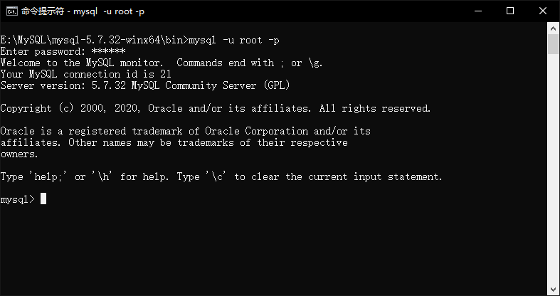
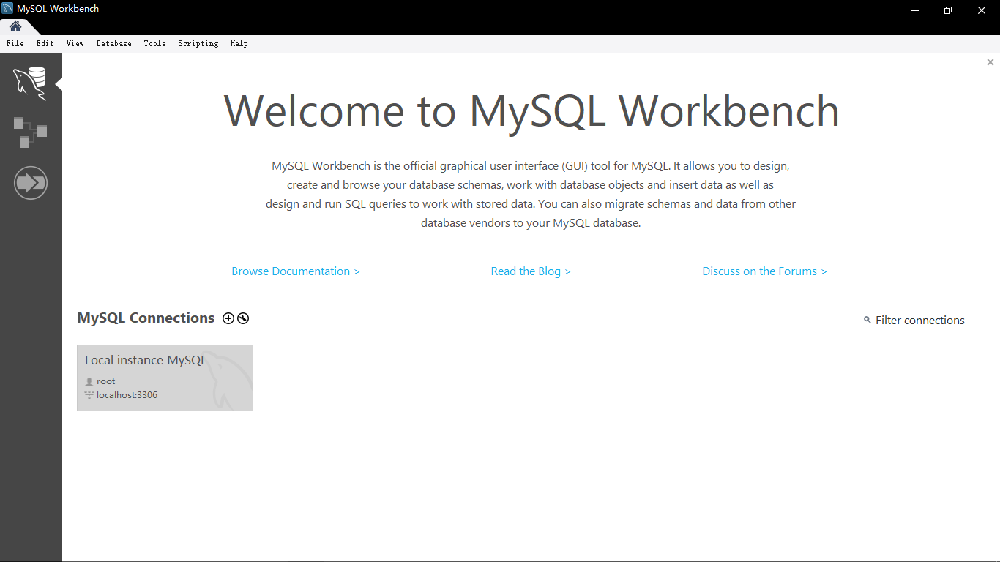
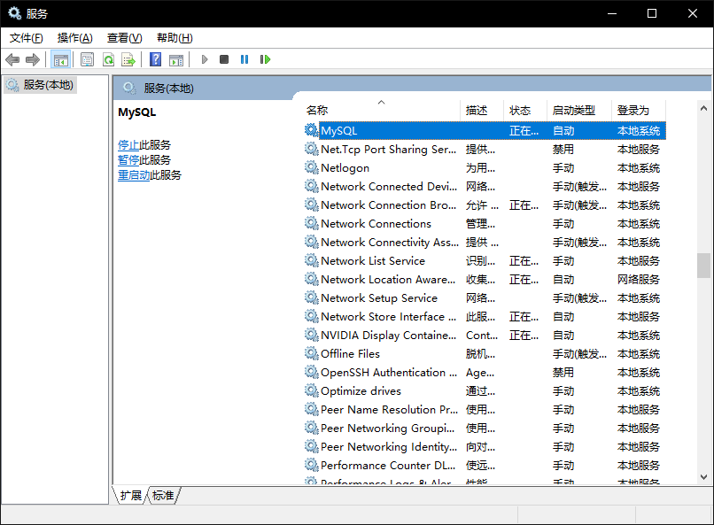

Windows系统下的MySQL环境搭建

## MySQL Server

### 下载 MySQL Server

最新版与 5.7 版本，按需下载

[MySQL Community Downloads Least](https://dev.mysql.com/downloads/mysql/)

[MySQL Community Downloads 5.7](https://dev.mysql.com/downloads/mysql/5.7.html)

### 解压后在目录中添加必要配置文件

_my.ini_

```ini
# from runoob
[mysqld]
# 设置3306端口
port = 3306
# 设置mysql的安装目录
basedir=E:\\MySQL\\mysql-5.7.32-winx64
# 设置 mysql数据库的数据的存放目录，MySQL 8+ 不需要以下配置，系统自己生成即可，否则有可能报错
datadir=E:\\MySQL\\mysql-5.7.32-winx64\\data
# 允许最大连接数
max_connections=20
# 服务端使用的字符集默认为8比特编码的latin1字符集
character-set-server=utf8
# 创建新表时将使用的默认存储引擎
default-storage-engine=INNODB
```

-   `basedir` 是 _MySQL_ 所在的绝对路径
-   `datadir` 是数据存放的绝对路径
-   路径中要用一个斜杠 `/` 或者双反斜杠 `\\` 来区分层次，不允许用单反斜杠

### 使用 cmd 进行 MySQL 配置

1.  使用**管理员模式**打开命令行窗口
    
2.  进入`MySQL\bin`所在目录: `>cd /d E:\MySQL\mysql-5.7.32-winx64\bin`
    
3.  初始化`MySQL`数据地址: `>mysqld --initialize --console`
    
    -   `--console` 表示将信息打印到控制台
    -   成功后会有初始用户 `root` 与其密码，请留意
4.  安装`MySQL`: `>mysqld install`
    
5.  启动`MySQL`服务器: `>net start mysql`
    
6.  登录`MySQL`服务器: `>mysql -u root -p`
    
    -   将会提示: `Enter password:`
    -   输入步骤 3 时获得的密码
    -   此时进入到 `mysql>` 控制台
7.  重设 `root`密码: `mysql>set password for root@localhost=password('newPassword');`
    
    -   注意结尾需要分号
    -   密码将会被设置为 `newPassword`
    -   之后用 _cmd_ 登录 _MySQL_ 不需要管理员模式  
        

## MySQL Workbench

> MySQL官方提供的图形化数据库管理工具

### 下载安装 MySQL Workbench

\[[Download MySQL Workbench\]](https://dev.mysql.com/downloads/workbench/)

傻瓜式安装

在 _MySQL_ 服务器运行状态下启动 _MySQL Workbench_ ，可以自动识别到，快捷连接



## 更换 MySQL 路径

> MySQL会将信息注册在Windows系统的service内，在更换MySQL的路径时需要先将MySQL服务删除，然后重新搭建环境

### 删除 MySQL 服务



1.  使用**管理员模式**打开命令行窗口
2.  `>sc delete MySQL`

### 重新搭建 MySQL 环境

重复上文内容
