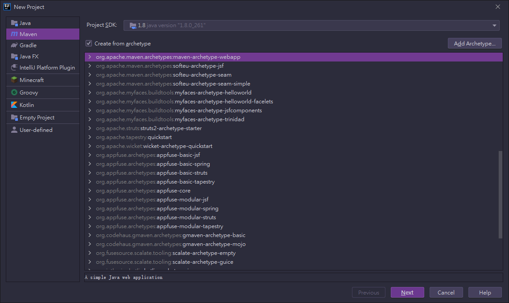
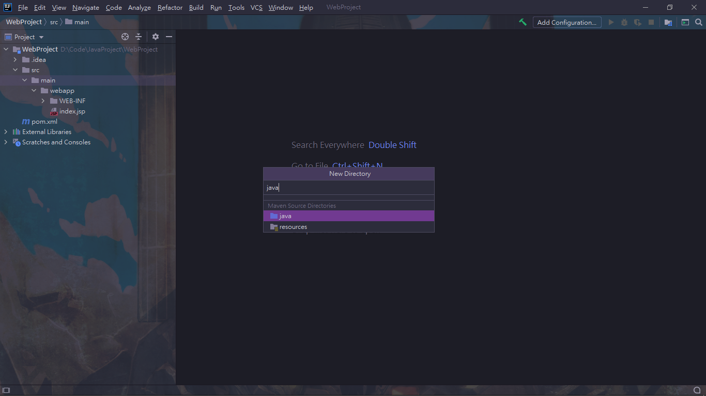
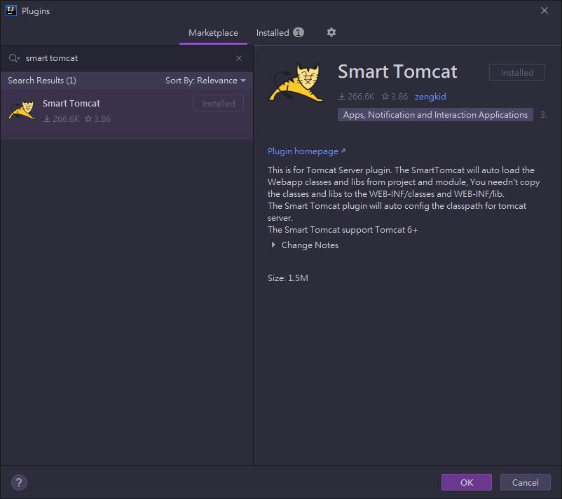
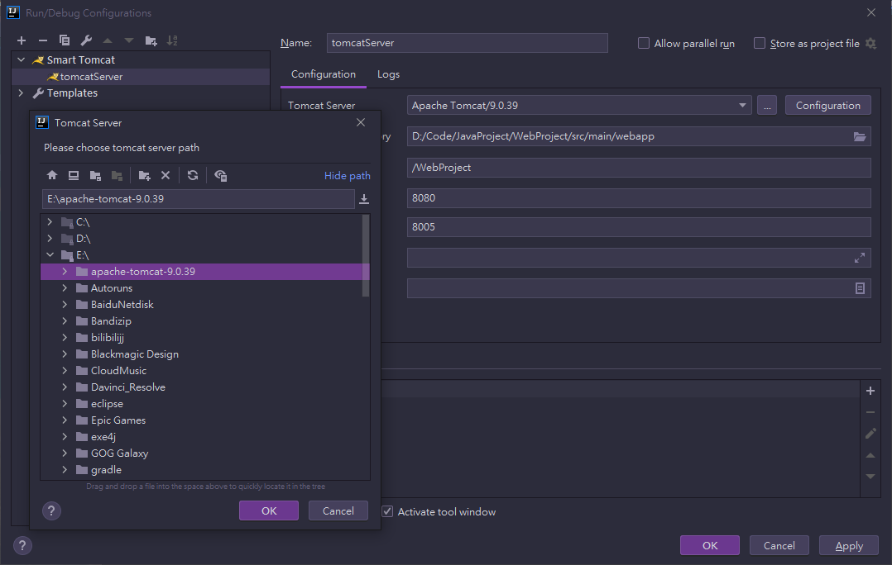
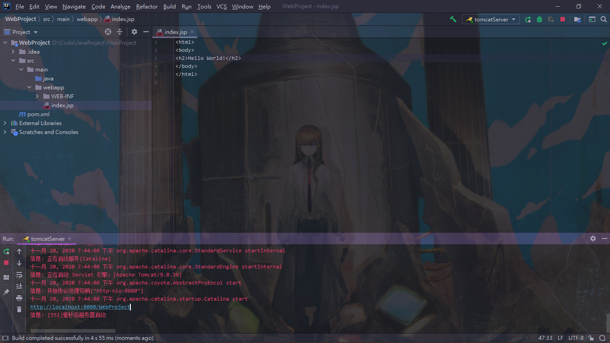
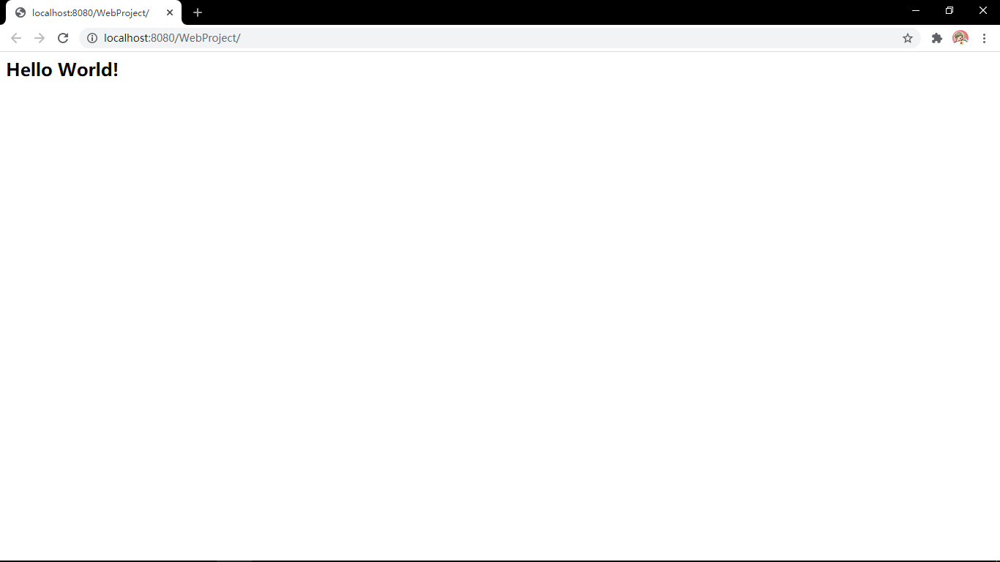

本来因为IDEA的Community版本没有自带支持Web和JavaEE的快捷开发, 所以尝试转用Eclipse. 但因为Eclipse太痛苦了, 十分不习惯, 所以还是找了IDEA的方法

`Community`版本的`IDEA`也是可以进行`JavaEE`+`Tomcat`的`Web`开发的, 只是没有类似`Ultimate`版本的快捷选项罢了

## 创建项目

创建新的`Maven`项目, 并选择如下



## 配置pom.xml

然后等待处理完成

如果没问题的话就等`IDEA`慢慢下插件和依赖

_pom.xml_将会有类似如下内容

```xml
<?xml version="1.0" encoding="UTF-8"?>

<project xmlns="http://maven.apache.org/POM/4.0.0" xmlns:xsi="http://www.w3.org/2001/XMLSchema-instance"
  xsi:schemaLocation="http://maven.apache.org/POM/4.0.0 http://maven.apache.org/xsd/maven-4.0.0.xsd">
  <modelVersion>4.0.0</modelVersion>

  <groupId>tomoto</groupId>
  <artifactId>WebProject</artifactId>
  <version>1.0</version>
  <packaging>war</packaging>

  <name>WebProject Maven Webapp</name>
  <!-- FIXME change it to the project's website -->
  <url>http://www.example.com</url>

  <properties>
    <project.build.sourceEncoding>UTF-8</project.build.sourceEncoding>
    <maven.compiler.source>1.7</maven.compiler.source>
    <maven.compiler.target>1.7</maven.compiler.target>
  </properties>

  <dependencies>
    <dependency>
      <groupId>junit</groupId>
      <artifactId>junit</artifactId>
      <version>4.11</version>
      <scope>test</scope>
    </dependency>
  </dependencies>

  <build>
    <finalName>WebProject</finalName>
    <pluginManagement><!-- lock down plugins versions to avoid using Maven defaults (may be moved to parent pom) -->
      <plugins>
        <plugin>
          <artifactId>maven-clean-plugin</artifactId>
          <version>3.1.0</version>
        </plugin>
        <!-- see http://maven.apache.org/ref/current/maven-core/default-bindings.html#Plugin_bindings_for_war_packaging -->
        <plugin>
          <artifactId>maven-resources-plugin</artifactId>
          <version>3.0.2</version>
        </plugin>
        <plugin>
          <artifactId>maven-compiler-plugin</artifactId>
          <version>3.8.0</version>
        </plugin>
        <plugin>
          <artifactId>maven-surefire-plugin</artifactId>
          <version>2.22.1</version>
        </plugin>
        <plugin>
          <artifactId>maven-war-plugin</artifactId>
          <version>3.2.2</version>
        </plugin>
        <plugin>
          <artifactId>maven-install-plugin</artifactId>
          <version>2.5.2</version>
        </plugin>
        <plugin>
          <artifactId>maven-deploy-plugin</artifactId>
          <version>2.8.2</version>
        </plugin>
      </plugins>
    </pluginManagement>
  </build>
</project>
```

如果需要`servlet`或者`javaee`的内容, 可以添加如下内容

```xml
<!-- https://mvnrepository.com/artifact/javax/javaee-api -->
<dependency>
    <groupId>javax</groupId>
    <artifactId>javaee-api</artifactId>
    <version>8.0</version>
    <scope>provided</scope>
</dependency>
<!-- https://mvnrepository.com/artifact/javax.servlet/servlet-api -->
<dependency>
    <groupId>javax.servlet</groupId>
    <artifactId>servlet-api</artifactId>
    <version>2.5</version>
    <scope>provided</scope>
</dependency>
```

## 创建源代码文件夹

这种方式创建的项目并不会自动创建_main_和_java_目录, 所以需要手动创建



## 使用 smart tomcat 插件

插件商店找`smart tomcat`并安装



## 配置 Run / Debug 项

新增一个`tomcat`启动配置

改名, 名称随意

选择`tomcat`的安装路径



## 运行测试

运行, 直到出现如下信息



点击链接打开浏览器



成功
