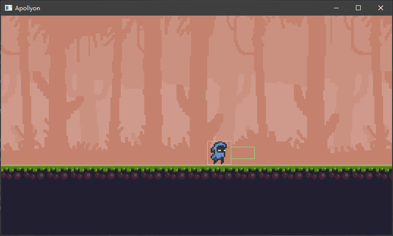

实现了 相机边界 & 跟随Actor & 跟随死区 的功能

## 效果



## 代码

`GameConstant.PIXEL_PER_UNIT`为项目自定义数值, 此处为16

```java
import com.badlogic.gdx.graphics.OrthographicCamera;
import com.badlogic.gdx.math.Rectangle; 
import com.badlogic.gdx.math.Vector2;
import com.badlogic.gdx.math.Vector3;
import com.badlogic.gdx.scenes.scene2d.Actor;
import io.tomoto.apollyon.utils.GameConstant;
import lombok.Getter;
import lombok.Setter;

/**
 * 妙妙相机
 *
 * @author Tomoto
 * @version 1.0 2022/8/22 18:13
 * @since 1.0
 */
@Getter
@Setter
public class FancyCamera extends OrthographicCamera {
    /**
     * 相机边界
     */
    private Rectangle boundary;

    /**
     * 跟随死区
     * <p>
     * 需启用lerp平滑跟随
     */
    private Vector2 deadZone;

    /**
     * 跟随目标
     */
    private Actor target;

    /**
     * 是否使用lerp平滑跟随
     */
    private boolean lerp;

    public FancyCamera() {
        deadZone = new Vector2(0, 0); // 默认死区宽高为0
    }

    @Override
    public void update() {
        /* 跟随判断 */
        if (target == null) {
            return;
        }

        Vector2 targetPosition = target.localToParentCoordinates(new Vector2(0, 0));
        Vector3 finalPosition = new Vector3(position);

        /* 死区判断 */
        if (lerp) {
            if (position.x - deadZone.x > targetPosition.x || position.x + deadZone.x < targetPosition.x) { // x死区
                finalPosition.x = targetPosition.x;
            }
            if (position.y - deadZone.y > targetPosition.y || position.y + deadZone.y < targetPosition.y) { // y死区
                finalPosition.y = targetPosition.y;
            }
        }

        /* 边界判断 */
        if (boundary != null) {
            if (finalPosition.x < boundary.x) { // 左边界
                finalPosition.x = boundary.x;
            }
            if (finalPosition.y < boundary.y) { // 下边界
                finalPosition.y = boundary.y;
            }
            if (finalPosition.x > boundary.x + boundary.width) { // 右边界
                finalPosition.x = boundary.x + boundary.width;
            }
            if (finalPosition.y > boundary.y + boundary.height) { // 上边界
                finalPosition.y = boundary.y + boundary.height;
            }
        }

        /* lerp平滑跟随 */
        if (lerp) {
            finalPosition.x = position.x + (finalPosition.x - position.x) / (GameConstant.PIXEL_PER_UNIT * 2);
            finalPosition.y = position.y + (finalPosition.y - position.y) / (GameConstant.PIXEL_PER_UNIT * 2);
        }

        position.set(finalPosition);
        super.update();
    }
}

```

## 用例

```java
@Override
public void show() {
    this.camera = new FancyCamera();
    this.camera.position.set(viewport.getWorldWidth() / 2, viewport.getWorldHeight() / 2, 0);

    /* 设置相机跟随 */
    this.camera.setTarget(this.stage.getApollyon());
    this.camera.setLerp(true);
    this.camera.setBoundary(new Rectangle(
            viewport.getWorldWidth() / 2,
            viewport.getWorldHeight() / 2,
            stage.getMapWidth() - viewport.getWorldWidth(),
            stage.getMapHeight() - viewport.getWorldHeight()));
    this.camera.setDeadZone(new Vector2(Player.SIZE / GameConstant.PIXEL_PER_UNIT, 0));
}
```
